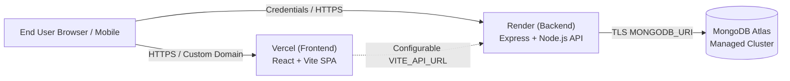

# Mise Meal Planner: Production Deployment Guide

This guide details the exact step-by-step procedure and dashboard configuration for deploying the Mise Meal Planner MERN stack to **MongoDB Atlas**, **Render** (Express backend), and **Vercel** (React/Vite frontend).

---

## 1. Architecture Overview



---

## 2. Environment Variables Checklist

### Backend Service (Render)

| Variable Name | Required | Example / Recommended Value | Description |
| :--- | :--- | :--- | :--- |
| `NODE_ENV` | Yes | `production` | Enables secure cookies (`SameSite=None; Secure`), production optimizations |
| `PORT` | Yes | `10000` *(auto-injected by Render)* | Port for Express server |
| `MONGODB_URI` | Yes | `mongodb+srv://<user>:<password>@cluster0.xxxxx.mongodb.net/mise_meal_planner?retryWrites=true&w=majority` | MongoDB Atlas cluster connection string |
| `JWT_SECRET` | Yes | `generate_with_crypto_random_bytes_64` | Secret key for signing session JWT tokens |
| `CLIENT_URL` | Yes | `https://your-frontend.vercel.app` | Allowed CORS origin for cross-domain cookie exchange |
| `OPENAI_API_KEY` | Optional | `sk-proj-...` | OpenAI secret key for AI leftover recipes & natural language planning |
| `OPENAI_MODEL` | Optional | `gpt-4o-mini` | OpenAI model ID (default `gpt-4o-mini`) |
| `OPENAI_TIMEOUT_MS` | Optional | `15000` | OpenAI request timeout in milliseconds |
| `ENABLE_AI_FEATURES` | Optional | `true` | Toggle AI endpoints (defaults to true if key is present; falls back safely if false) |
| `AI_RATE_LIMIT_MAX` | Optional | `15` | Max AI requests per user/IP per 10-minute window |
| `FREE_TIER_WEEKLY_AI_QUERIES` | Optional | `5` | Weekly AI quota for free users (Pro tier has 50) |

### Frontend Application (Vercel)

| Variable Name | Required | Example / Recommended Value | Description |
| :--- | :--- | :--- | :--- |
| `VITE_API_URL` | Yes | `https://mise-backend-api.onrender.com` | Production URL of your deployed Render backend (no trailing slash) |

---

## 3. Database Deployment: MongoDB Atlas

1. **Create Cluster**:
   - Log into [MongoDB Atlas](https://cloud.mongodb.com/).
   - Create a free (M0) or dedicated cluster in your target region (e.g., AWS / `us-east-1` or `eu-west-2`).
2. **Database Access (User Credentials)**:
   - Navigate to **Security > Database Access**.
   - Create a database user (e.g., `mise_admin`) with `Read and write to any database` privilege and a strong random password.
3. **Network Access (IP Whitelist)**:
   - Navigate to **Security > Network Access**.
   - Add IP access: `0.0.0.0/0` (Allow Access from Anywhere) to permit connections from Render's dynamic outbound IPs.
4. **Obtain Connection String**:
   - Click **Connect > Drivers > Node.js**.
   - Copy connection string: `mongodb+srv://<username>:<password>@cluster0.xxxxx.mongodb.net/mise_meal_planner?retryWrites=true&w=majority`.
5. **Initial Seeding**:
   - After setting `MONGODB_URI` on Render or locally, run `npm run seed --workspace=server` to populate the initial recipe catalog and indexes without affecting existing user accounts.

---

## 4. Backend Deployment: Render

### Method A: Blueprint Deployment (Recommended)
The repository contains [`render.yaml`](../render.yaml).
1. Connect your GitHub repository to [Render Dashboard](https://dashboard.render.com/).
2. Select **Blueprints > New Blueprint Instance**.
3. Render automatically reads `render.yaml` and sets up the Web Service.
4. Input the values for `MONGODB_URI` and `CLIENT_URL` in the prompts.

### Method B: Manual Web Service Setup
1. In Render Dashboard, click **New > Web Service**.
2. Connect your GitHub repository.
3. Configure the following fields:
   - **Name**: `mise-backend-api`
   - **Region**: Oregon or closest to your Atlas cluster
   - **Branch**: `main` (or `master`)
   - **Root Directory**: **Leave blank** (monorepo root)
     > **Critical Workspace Requirement**: The Render Root Directory must remain **blank** (repository root). Do NOT set it to `server`. Setting Root Directory to `server` bypasses the monorepo workspace orchestration in root `package.json`, causing `npm run build --workspace=server` and `npm run start:server` to fail.
   - **Runtime**: `Node`
   - **Build Command**: `npm install && npm run build --workspace=server`
   - **Start Command**: `npm run start:server`
   - **Health Check Path**: `/api/health`
4. Add Environment Variables:
   - `NODE_ENV`: `production`
   - `PORT`: `10000` (auto-injected or manually set)
   - `MONGODB_URI`: `<your-atlas-connection-string>`
   - `JWT_SECRET`: `<your-random-jwt-secret-minimum-32-chars>`
   - `CLIENT_URL`: `https://your-mise-app.vercel.app` (comma-separated if multiple)
   - `STRIPE_WEBHOOK_SECRET`: `<your-stripe-webhook-secret>` (when live billing active)

---

## 5. Frontend Deployment: Vercel

1. In [Vercel Dashboard](https://vercel.com/), click **Add New... > Project**.
2. Import your GitHub repository.
3. Configure project settings:
   - **Framework Preset**: `Vite`
   - **Root Directory**: `client` (Click "Edit" and choose `client`)
   - **Build Command**: `npm run build`
   - **Output Directory**: `dist`
   - **Install Command**: `npm install`
4. Add Environment Variable:
   - `VITE_API_URL`: `https://mise-backend-api.onrender.com` (your actual Render service URL)
5. **SPA Routing**:
   - The repository includes [`client/vercel.json`](../client/vercel.json) with rewrite rules (`"source": "/(.*)", "destination": "/index.html"`), ensuring routes like `/app/plan`, `/privacy`, `/terms` work seamlessly on direct navigation and browser refresh.
6. Deploy!

---

## 6. Verification and Health Checks

1. **Backend Health Check**:
   ```bash
   curl -i https://your-backend.onrender.com/api/health
   # Expected response: HTTP 200 OK
   # {"status":"ok","service":"mise-backend-api","timestamp":"..."}
   ```
2. **CORS & Cookie Transmission**:
   - Inspect network headers in browser DevTools when registering or logging in.
   - Verify `mise_token` cookie includes `SameSite=None; Secure; HttpOnly`.
3. **Frontend SPA Navigation**:
   - Open `https://your-app.vercel.app/app/plan`.
   - Refresh the page to verify rewrite rules properly serve `index.html` without 404 errors.
